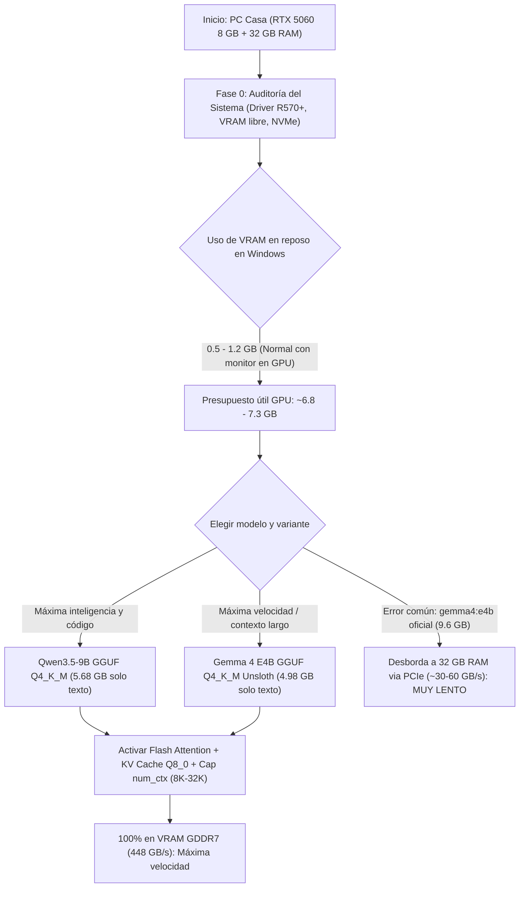
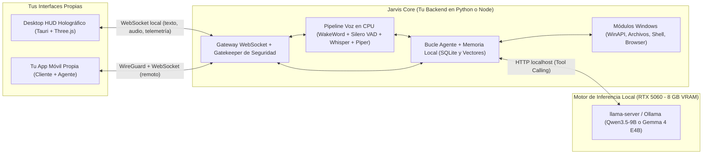

# Informe Técnico de Implementación Local: Qwen3.5-9B (Q4_K_M) y Gemma 4 E4B en RTX 5060 (8 GB) + 32 GB RAM

> [!IMPORTANT]
> **Constancia de entorno y alcance (Aviso obligatorio)**
> Este informe ha sido elaborado exclusivamente con base en las especificaciones objetivo indicadas para el **PC de tu casa** (**NVIDIA GeForce RTX 5060 de 8 GB VRAM** y **32 GB de RAM**), y **NO** corresponde al hardware del PC de trabajo desde el cual se generó este documento.
>
> **Antes de ejecutar cualquier instalación en el PC de casa, es obligatorio realizar un análisis previo del sistema** (detallado en la **Fase 0**) para verificar la versión exacta de GPU/controlador NVIDIA, la VRAM libre real bajo Windows, el tipo de almacenamiento disponible (NVMe recomendado), la memoria RAM y las capacidades del sistema operativo.

---

## 1. Resumen Ejecutivo y Validación Técnica

Tu planteamiento base es técnicamente correcto y refleja con precisión la física de inferencia local de Modelos de Lenguaje (LLM):

1. **La VRAM marca el muro de velocidad:** La **NVIDIA GeForce RTX 5060 (8 GB)** utiliza arquitectura **Blackwell (GB206, capacidad de cómputo `sm_120`)**, 3,840 núcleos CUDA y memoria **GDDR7 de 128 bits a 28 Gbps**, lo que entrega un ancho de banda de **448 GB/s** (un salto enorme frente a los ~272 GB/s de la RTX 4060). La generación de texto token por token depende directamente de ese ancho de banda.
2. **Qué pasa si te pasas de los 8 GB:** Si los pesos del modelo, la caché de contexto (KV Cache) o los buffers de trabajo superan la VRAM disponible, la carga se divide hacia los **32 GB de RAM del sistema** a través del bus PCIe (cuyo ancho de banda efectivo cae al orden de **30–60 GB/s**). El modelo seguirá funcionando, pero la velocidad en tokens por segundo caerá drásticamente.

### Tres hallazgos críticos de la investigación (lo que debes saber antes de instalar)

Al investigar a fondo ambos modelos en su estado actual, aparecen **tres detalles clave** que determinan si tu instalación irá rapidísima dentro de los 8 GB o si fallará/desbordará hacia la RAM:

> [!WARNING]
> **Trampa n.º 1: El `gemma4:e4b` oficial de Ollama pesa 9.6 GB**
> Aunque **Gemma 4 E4B** tiene ~4.5B parámetros efectivos (con ~8B totales debido a sus *Per-Layer Embeddings* o PLE), el paquete oficial `ollama run gemma4:e4b` pesa **9.6 GB** en disco porque conserva componentes de precisión alta y proyector multimodal. **En una RTX 5060 de 8 GB se desbordará obligatoriamente a la RAM.**
> **Solución:** Usar la versión GGUF optimizada de Unsloth (`unsloth/gemma-4-E4B-it-GGUF`), donde **`Q4_K_M` pesa ~4.98 GB** (`UD-Q4_K_XL` pesa **5.13 GB**), dejando espacio amplio en VRAM para contextos largos.

> [!WARNING]
> **Trampa n.º 2: En `Qwen3.5-9B`, el proyector de visión (`mmproj`) marca la diferencia**
> La descarga estándar `qwen3.5:9b` en Ollama pesa **~6.6 GB** porque incluye el componente multimodal de visión (`mmproj` de ~918–922 MB). En Windows, el sistema operativo ya ocupa entre **0.5 GB y 1.2 GB** de VRAM para el escritorio, por lo que 6.6 GB deja un margen mínimo (~0.5–1.0 GB) y obliga a recortar el contexto a `4096`–`8192` tokens.
> **Solución:** Si vas a usarlo principalmente para texto y código, usa el GGUF de texto puro **`unsloth/Qwen3.5-9B-GGUF` (`Q4_K_M` = 5.68 GB o `Q4_K_S` = 5.39 GB)** sin cargar el `mmproj`, ganando ~1 GB adicional de VRAM para trabajar cómodamente con **16K–32K de contexto** 100 % en GPU.

> [!TIP]
> **Trampa n.º 3: El "fallback silencioso" de NVIDIA en Windows**
> Desde los drivers NVIDIA 536.40+, Windows activa por defecto la política **CUDA - Sysmem Fallback**, que mueve silenciosamente datos desbordados de VRAM a la RAM sin dar error. Esto hace creer al usuario que el modelo cupo en la GPU mientras la velocidad cae a 1–5 tokens/s. En la configuración incluiremos cómo desactivarlo (`Prefer No Sysmem Fallback`) para tener control total.

---

## 2. Por qué estos dos modelos funcionan tan bien en 8 GB de VRAM

Ambos modelos fueron diseñados en 2026 con arquitecturas híbridas modernas que reducen drásticamente el consumo de memoria de contexto (KV Cache) en comparación con los Transformers tradicionales:

| Característica | Qwen3.5-9B (`Q4_K_M`) | Gemma 4 E4B (`Q4_K_M` Unsloth) |
| :--- | :--- | :--- |
| **Rol ideal en tu PC** | **Equilibrio máximo entre inteligencia, razonamiento y código** | **Máxima velocidad y ventanas de contexto más amplias** |
| **Parámetros** | ~9B denso (multimodal nativo) | ~4.5B efectivos / ~8B totales con *Per-Layer Embeddings (PLE)* |
| **Arquitectura de atención** | **32 capas en patrón 3:1**: 24 capas *Gated DeltaNet* (atención lineal, estado fijo $O(1)$ sin KV cache creciente) + 8 capas *Gated Attention* (GQA 4:1) | **Patrón 5:1**: 5 capas de ventana deslizante local (*Sliding Window* de **512 tokens**) por cada 1 capa global + **KV Cache Sharing (18/42)** entre capas |
| **Ventana de contexto nativa** | 262,144 tokens (256K) | 128,000 tokens (128K) |
| **Tamaño GGUF `Q4_K_M` (solo texto)** | **~5.68 GB** (`Q4_K_S`: 5.39 GB, `IQ4_XS`: 5.17 GB) | **~4.98 GB** (`UD-Q4_K_XL`: 5.13 GB, `Q4_0`: 4.84 GB) |
| **Tamaño proyector multimodal (`mmproj`)** | **~918–922 MB** (visión) | **~990–992 MB** (visión/audio) |
| **Tamaño paquete oficial Ollama** | **~6.6 GB** (`qwen3.5:9b`) | **~9.6 GB** (`gemma4:e4b` — *desborda 8 GB*) |
| **Modo de razonamiento (*Thinking*)** | Nativo (`<think>`), activable/desactivable | Nativo (`<\|channel>thought...<channel\|>`), configurable |

### Flujo de decisión de memoria en la RTX 5060 (8 GB)



---

## 3. Fase 0: Auditoría Obligatoria del Sistema (En el PC de casa)

Antes de descargar modelos o instalar programas en el PC de casa, abre **PowerShell** (no hace falta administrador para lectura) y ejecuta este bloque de diagnóstico para dejar constancia del estado real de tu equipo:

```powershell
Write-Host "=== 1. GPU, DRIVER Y VRAM ===" -ForegroundColor Cyan
nvidia-smi

Write-Host "`n=== 2. DETALLE PCIE / RESIZABLE BAR ===" -ForegroundColor Cyan
nvidia-smi -q -d MEMORY,PCIE

Write-Host "`n=== 3. CPU Y RAM ===" -ForegroundColor Cyan
Get-CimInstance Win32_Processor | Select-Object Name, NumberOfCores, NumberOfLogicalProcessors
Get-CimInstance Win32_PhysicalMemory | Select-Object Capacity, Speed, Manufacturer

Write-Host "`n=== 4. DISCOS Y ESPACIO LIBRE ===" -ForegroundColor Cyan
Get-PhysicalDisk | Select-Object FriendlyName, MediaType, BusType, Size
Get-PSDrive -PSProvider FileSystem | Select-Object Name, @{N="FreeGB";E={[math]::Round($_.Free/1GB,2)}}

Write-Host "`n=== 5. WINDOWS Y WSL2 ===" -ForegroundColor Cyan
Get-CimInstance Win32_OperatingSystem | Select-Object Caption, Version, OSArchitecture
wsl --status
```

### Checklist de validación de la Auditoría

| Componente a verificar | Qué debes observar | Si no cumple, qué hacer |
| :--- | :--- | :--- |
| **GPU detectada (`nvidia-smi`)** | `NVIDIA GeForce RTX 5060`, `8188 MiB` aprox. | Verifica conexión física PCIe y cables de alimentación PCIe de la fuente (TDP ~145–150W). |
| **Driver NVIDIA (`Driver Version`)** | **Versión `570.xx` o superior** (requerido para Blackwell `sm_120` y **CUDA 12.8+**) | Descarga e instala el último NVIDIA Game Ready o Studio Driver antes de continuar. Sin R570+ fallará con *"no kernel image is available for execution"*. |
| **VRAM ocupada en reposo** | Idealmente **< 900 MiB** antes de abrir IA | Cierra navegadores con aceleración por hardware o apps pesadas. *(Tip: si tu procesador tiene gráfica integrada iGPU y conectas el monitor a la placa base, liberarás casi los 8 GB completos para la RTX 5060).* |
| **RAM del sistema** | **32 GB** totales detectados (idealmente en Dual Channel) | Sirve como respaldo si algún día pruebas modelos > 8 GB o cargas herramientas como Docker/Open WebUI. |
| **Almacenamiento libre** | Al menos **30–40 GB libres en SSD NVMe** | Evita instalar modelos en discos HDD mecánicos; cargar 5–6 GB desde HDD puede tardar minutos en vez de ~1–2 segundos en NVMe. |

---

## 4. Presupuesto Real de VRAM (8 GB) y Ventanas de Contexto

En Windows 10/11, el controlador WDDM reserva memoria para el escritorio y aplicaciones abiertas. Contando con un presupuesto útil conservador de **~6.8 a 7.3 GB**, así se distribuyen las configuraciones recomendadas (*estimaciones basadas en tamaños de archivo verificados + sobrecarga típica de WDDM, buffers de cómputo y caché KV*):

| Configuración | Peso del modelo | Presupuesto restante para KV Cache + Buffers (de ~7.0 GB útiles) | Contexto seguro 100 % en GPU (con Flash Attention + KV `q8_0`) | ¿Cabe 100 % en RTX 5060? |
| :--- | :--- | :--- | :--- | :--- |
| **Gemma 4 E4B (`unsloth Q4_K_M` texto)** | **4.98 GB** | ~2.0 GB | **16,384 – 32,768 tokens** (32K muy viable por ventana deslizante y KV sharing) | **Sí, con holgura** |
| **Gemma 4 E4B (`unsloth UD-Q4_K_XL` texto)** | **5.13 GB** | ~1.85 GB | **16,384 – 32,768 tokens** | **Sí** |
| **Gemma 4 E4B + `mmproj` (visión/audio)** | ~5.97 GB | ~1.0 GB | **8,192 – 16,384 tokens** | **Sí (ajustado)** |
| **Gemma 4 E4B oficial Ollama (`gemma4:e4b`)** | **9.60 GB** | **-2.6 GB (desborda)** | Desborda a RAM incluso con contexto mínimo | **NO (spilling a RAM)** |
| **Qwen3.5-9B (`unsloth Q4_K_S` texto)** | **5.39 GB** | ~1.6 GB | **16,384 – 32,768 tokens** (solo 8/32 capas acumulan KV cache) | **Sí** |
| **Qwen3.5-9B (`unsloth Q4_K_M` texto)** | **5.68 GB** | ~1.3 GB | **8,192 – 16,384 tokens** (24K–32K posible si VRAM en reposo < 0.7 GB) | **Sí** |
| **Qwen3.5-9B oficial Ollama (`qwen3.5:9b`)** | **6.60 GB** | ~0.4 – 0.8 GB | **4,096 – 8,192 tokens** (muy al límite en Windows) | **Muy justo / riesgo de spill** |

> [!TIP]
> **Por qué debes activar Flash Attention + KV Cache `q8_0` siempre:**
> - **Flash Attention** acelera el procesamiento de contexto largo y es **requisito obligatorio** para cuantizar la caché KV.
> - **KV Cache `q8_0`** reduce a la mitad (~53 %) la memoria de contexto respecto al formato por defecto `f16` sin pérdida perceptible de inteligencia. No se recomienda `q4_0` salvo emergencia extrema, porque puede degradar lógica en contextos largos y añadir sobrecarga de descuantización.

---

## 5. Elección de Plataforma: ¿Qué stack instalar?

Tienes tres formas sólidas de implementar esto en Windows. Para una GPU de **8 GB de VRAM**, la **Opción A (LM Studio)** suele ser la más segura y visual al principio, mientras que la **Opción B (Ollama + Open WebUI)** es mejor si quieres un portal web estilo ChatGPT con documentos (RAG) y servicio en segundo plano.

| Criterio | Opción A: LM Studio (`0.4.x`) — **Recomendada** | Opción B: Ollama (`≥ 0.22`) + Open WebUI | Opción C: `llama.cpp` (`llama-server`) |
| :--- | :--- | :--- | :--- |
| **Facilidad para 8 GB VRAM** | **Excelente**: medidor visual de VRAM, activas/desactivas `mmproj` y KV `Q8_0` con clics | Media: requiere variables de entorno y `Modelfile` / `hf.co` para evitar `gemma4:e4b` de 9.6 GB | Avanzada: todo por línea de comandos |
| **Soporte RTX 5060 (Blackwell)** | Nativo desde v0.3.15+ (runtime **CUDA 12.8+** automático) | Nativo con driver **R570+** | Nativo con binarios CUDA 12.8+ o compilado con `sm_120` |
| **Interfaz de Chat y API** | App de escritorio integrada + servidor API OpenAI (`localhost:1234`) | CLI + API (`localhost:11434`) + Open WebUI web (`localhost:3000` / `8080`) | Interfaz web ligera integrada + API OpenAI |
| **Sobrecarga de memoria** | Baja | Media-baja (más Docker/Python si usas Open WebUI) | **Mínima** (~100–200 MB menos) |

---

## 6. Guía de Implementación Paso a Paso

### Paso 1: Preparar Windows y NVIDIA (Común a todas las opciones)

1. **Actualizar Driver NVIDIA:**
   - Verifica en `nvidia-smi` que tengas versión **570.xx o superior**. Si es inferior, actualiza desde la NVIDIA App o web oficial de NVIDIA.
2. **Desactivar el fallback silencioso a RAM (muy recomendado):**
   - Haz clic derecho en el escritorio -> **Panel de control de NVIDIA**.
   - Ve a **Controlar la configuración 3D** -> pestaña **Configuración de programa** (o Global si prefieres aplicarlo estricto).
   - Agrega el ejecutable de tu motor (`LM Studio.exe` / `llama-server.exe` / `ollama_llama_server.exe`).
   - Busca la opción **CUDA - Sysmem Fallback Policy** (*Directiva de reserva de memoria del sistema CUDA*).
   - Cámbiala de *Driver Default* a **Prefer No Sysmem Fallback**.
   - Haz clic en **Aplicar**.
   - *Beneficio:* Si alguna vez configuras un contexto demasiado grande, el programa te avisará con un error claro de falta de memoria en lugar de arrastrarse silenciosamente a 1–2 tok/s usando la RAM.
3. **Reducir consumo de VRAM en segundo plano:**
   - Si usas Chrome/Edge/Discord abiertos mientras chateas con tu LLM local, desactiva en ellos la *Aceleración por hardware/gráficos* si notas que te quitan más de 500–800 MB de VRAM.

---

### Paso 2A: Implementación con LM Studio (Ruta Recomendada)

1. **Instalar LM Studio:**
   - Descarga la última versión para Windows (`0.4.x`, mínimo `0.3.15+`) desde [lmstudio.ai](https://lmstudio.ai).
   - Al abrirlo, ve a **Settings / Runtime** (icono de ajustes / motor) y verifica que el **CUDA llama.cpp runtime (CUDA 12.8 o superior)** esté instalado y seleccionado para tu RTX 5060.

2. **Descargar exactamente los dos modelos óptimos (desde la pestaña Discover / lupa):**
   - **Modelo 1 (Equilibrio / Inteligencia / Código):**
     - Busca: `unsloth/Qwen3.5-9B-GGUF`
     - Descarga el archivo **`Qwen3.5-9B-Q4_K_M.gguf`** (**~5.68 GB**). *(Alternativa si quieres aún más margen para contexto largo: `Qwen3.5-9B-Q4_K_S.gguf` de **5.39 GB**).*
   - **Modelo 2 (Velocidad / Contextos largos):**
     - Busca: `unsloth/gemma-4-E4B-it-GGUF`
     - Descarga el archivo **`gemma-4-E4B-it-Q4_K_M.gguf`** (**~4.98 GB**) o **`gemma-4-E4B-it-UD-Q4_K_XL.gguf`** (**~5.13 GB**).
   - *Nota sobre multimodalidad (`mmproj`):* LM Studio puede descargar automáticamente el `mmproj` si está en el repo. En la pantalla de carga del modelo, desactiva la carga del proyector de visión/audio cuando no vayas a enviar imágenes para ahorrar ~920–990 MB de VRAM.

3. **Configurar los parámetros de carga (Model Load Settings — CRÍTICO para 8 GB):**
   Antes de cargar cada modelo, activa **"Manually choose model load parameters"** (o el engranaje de carga) y configura:
   - **GPU Offload:** Al **100 % / Máximo** (todas las capas en GPU: ej. `32/32` en Qwen3.5-9B).
   - **Context Length (`n_ctx`):**
     - Para `Qwen3.5-9B Q4_K_M`: empieza en **`16384`** (16K). Si ves que queda VRAM libre en `nvidia-smi`, puedes probar **`24576`** o **`32768`**.
     - Para `Gemma 4 E4B Q4_K_M`: empieza en **`32768`** (32K). Si el texto es puro y tu VRAM en reposo es baja, puedes probar hasta **`49152`–`65536`** vigilando `nvidia-smi`.
   - **Flash Attention:** **Activado (ON)**.
   - **K Cache Quantization Type / V Cache Quantization Type:** **`Q8_0`** en ambos.
   - **Auto-unload / No mantener dos modelos a la vez:** Asegúrate de descargar un modelo antes de cargar el otro (dos modelos de ~5 GB no caben juntos en 8 GB).

4. **Configurar los parámetros de muestreo recomendados por los creadores:**
   - **Para `Qwen3.5-9B`:**
     - *Modo Thinking activado (razonamiento general):* `Temperature = 1.0`, `Top-P = 0.95`, `Top-K = 20`, `Min-P = 0.0`, `Presence Penalty = 1.5`, `Repeat Penalty = 1.0`.
     - *Modo Thinking activado (programación/código preciso):* `Temperature = 0.6`, `Top-P = 0.95`, `Top-K = 20`, `Min-P = 0.0`, `Presence Penalty = 0.0`, `Repeat Penalty = 1.0`.
     - *Modo Non-Thinking (respuestas rápidas sin bloque `<think>`):* desactiva el pensamiento en la plantilla de chat (`enable_thinking: false`) y usa `Temperature = 0.7`, `Top-P = 0.80`, `Top-K = 20`, `Min-P = 0.0`, `Presence Penalty = 1.5`, `Repeat Penalty = 1.0`.
   - **Para `Gemma 4 E4B`:**
     - Configuración oficial de Google: `Temperature = 1.0`, `Top-P = 0.95`, `Top-K = 64`.

5. **Integración opcional con VS Code (si programas en casa):**
   - En LM Studio ve a la pestaña **Developer (Local Server)** -> **Start Server** (`http://localhost:1234/v1`).
   - En extensiones como **Continue** o **Cline**, apunta el proveedor *OpenAI Compatible / LM Studio* a `http://localhost:1234/v1`.

---

### Paso 2B: Implementación Alternativa con Ollama + Open WebUI

Si prefieres tener un servicio de sistema en segundo plano y una interfaz web en el navegador tipo ChatGPT:

1. **Instalar Ollama para Windows:**
   - Descarga la versión más reciente desde [ollama.com](https://ollama.com) (asegúrate de tener **v0.22 o superior** para soporte nativo de Gemma 4 y Qwen 3.5).
   - **Cierra Ollama completamente** desde el icono de la bandeja del sistema (junto al reloj de Windows) antes del siguiente paso.

2. **Configurar variables de entorno del servidor Ollama (INDISPENSABLE en 8 GB):**
   - En el buscador de Windows abre **Editar las variables de entorno del sistema** -> **Variables de entorno...** -> en *Variables de usuario* crea las siguientes:
     - `OLLAMA_FLASH_ATTENTION` = `1`
     - `OLLAMA_KV_CACHE_TYPE` = `q8_0`
     - `OLLAMA_MAX_LOADED_MODELS` = `1` *(evita que Ollama intente mantener los dos modelos cargados al tiempo y desborde los 8 GB)*
     - `OLLAMA_KEEP_ALIVE` = `5m`
   - Vuelve a abrir la aplicación **Ollama** para que cargue con esas variables activas.

3. **Descargar los modelos correctos (evitando el de 9.6 GB) y fijar `num_ctx`:**
   En PowerShell, prueba las variantes GGUF optimizadas directamente desde Hugging Face con Ollama:
   ```powershell
   # Descargar Gemma 4 E4B optimizado (~5 GB en vez de los 9.6 GB del tag oficial)
   ollama pull hf.co/unsloth/gemma-4-E4B-it-GGUF:Q4_K_M

   # Descargar Qwen3.5-9B optimizado solo texto (~5.68 GB)
   ollama pull hf.co/unsloth/Qwen3.5-9B-GGUF:Q4_K_M
   ```
   *(Si prefieres usar el `qwen3.5:9b` oficial de Ollama de ~6.6 GB con visión, asegúrate de limitar el contexto a `4096`–`8192` mediante un `Modelfile`).*

   Para que el contexto no intente reservar memoria de más por defecto, crea dos `Modelfile` permanentes:

   **Archivo `Modelfile.qwen35`:**
   ```dockerfile
   FROM hf.co/unsloth/Qwen3.5-9B-GGUF:Q4_K_M
   PARAMETER num_ctx 16384
   PARAMETER temperature 0.6
   PARAMETER top_p 0.95
   PARAMETER top_k 20
   ```

   **Archivo `Modelfile.gemma4`:**
   ```dockerfile
   FROM hf.co/unsloth/gemma-4-E4B-it-GGUF:Q4_K_M
   PARAMETER num_ctx 32768
   PARAMETER temperature 1.0
   PARAMETER top_p 0.95
   PARAMETER top_k 64
   ```

   Regístralos en Ollama:
   ```powershell
   ollama create qwen35-9b-8gb -f Modelfile.qwen35
   ollama create gemma4-e4b-8gb -f Modelfile.gemma4
   ```

   - *Tip de velocidad en Ollama:* Para desactivar el modo pensamiento en sesiones rápidas de Qwen3.5 desde terminal, ejecuta `ollama run qwen35-9b-8gb --think=false` o escribe `/set nothink` dentro del chat.

4. **Instalar interfaz web con Open WebUI (sin Docker usando `uv`, o con Docker):**
   - **Vía `uv` (rápido y nativo en Windows, sin instalar Docker):**
     ```powershell
     powershell -ExecutionPolicy ByPass -c "irm https://astral.sh/uv/install.ps1 | iex"
     # Reinicia PowerShell y ejecuta:
     uvx --python 3.11 open-webui@latest serve
     ```
     Luego abre **`http://localhost:8080`** en tu navegador; detectará automáticamente Ollama en `http://localhost:11434`.
   - **Vía Docker Desktop (si ya usas WSL2/Docker):**
     ```powershell
     docker run -d -p 3000:8080 --add-host=host.docker.internal:host-gateway -v open-webui:/app/backend/data --name open-webui --restart always ghcr.io/open-webui/open-webui:main
     ```
     Luego abre **`http://localhost:3000`**.

---

### Paso 2C: Opción Minimalista con `llama.cpp` (`llama-server`)

Si quieres exprimir hasta los últimos 150 MB de VRAM sin interfaz intermedia, descarga los binarios Windows CUDA (`cuda-12.8+`) desde el repositorio oficial `ggml-org/llama.cpp` en GitHub (o compílalo con `-DGGML_CUDA=ON -DCMAKE_CUDA_ARCHITECTURES="120"`) y lanza:

```powershell
# Lanzar Qwen3.5-9B (16K contexto, 100% GPU, Flash Attention + KV Q8_0, modo sin pensamiento opcional)
llama-server.exe -hf unsloth/Qwen3.5-9B-GGUF:Q4_K_M -ngl 99 -c 16384 -fa on -ctk q8_0 -ctv q8_0 --port 8080

# O lanzar Gemma 4 E4B (32K contexto, 100% GPU, Flash Attention + KV Q8_0)
llama-server.exe -hf unsloth/gemma-4-E4B-it-GGUF:Q4_K_M -ngl 99 -c 32768 -fa on -ctk q8_0 -ctv q8_0 --port 8080
```
*(Si en algún caso puntual de `Qwen3.5-9B` quieres desactivar thinking en `llama-server`, añade `--chat-template-kwargs "{\"enable_thinking\": false}"`).*

---

## 7. Paso 3: Verificación y Pruebas de Rendimiento (Cómo comprobar que nada cayó a RAM)

Después de cargar un modelo y hacer una consulta larga, verifica **siempre** estos tres indicadores:

1. **En Ollama (`ollama ps`):**
   Ejecuta `ollama ps` mientras el modelo esté cargado:
   - **Correcto:** La columna `PROCESSOR` debe decir **`100% GPU`**.
   - **Incorrecto:** Si dice `85% GPU / 15% CPU` o similar, significa que superaste los 8 GB de VRAM y estás pagando la penalización de RAM/PCIe. Reduce `num_ctx` (ej. de `32768` a `16384` o `8192`).
2. **En LM Studio / `llama-server` (Consola de logs y métricas):**
   - Busca en el log de carga: todas las capas asignadas a CUDA (`offloaded X/X layers to GPU`).
   - Verifica al final de cada respuesta la métrica `tok/s` (*generation/eval speed*) y `prompt eval` (*time to first token*). Anota tu línea base real de casa para `Qwen3.5-9B` y `Gemma 4 E4B`.
3. **En `nvidia-smi` y Administrador de Tareas de Windows:**
   - Ejecuta `nvidia-smi` mientras genera texto: el consumo de VRAM debe mantenerse por debajo de ~7,800–8,000 MiB y `GPU-Util` debe subir con fuerza durante la generación.
   - En el **Administrador de Tareas -> Rendimiento -> GPU RTX 5060**, revisa **Memoria de GPU dedicada** (debe llenarse hasta ~6.5–7.7 GB) y **Memoria de GPU compartida** (debe permanecer cerca de **0.0 / 16.0 GB**; si empieza a subir varios gigabytes durante la inferencia, está usando RAM del sistema).

---

## 8. Solución de Problemas Frecuentes

| Síntoma | Causa probable | Solución directa |
| :--- | :--- | :--- |
| Error `no kernel image is available for execution` | Driver NVIDIA antiguo (< R570) o binario compilado sin soporte `sm_120` (CUDA < 12.8) | Actualiza Driver NVIDIA a **R570+** y actualiza LM Studio (`≥ 0.3.15` / `0.4.x`), Ollama (`≥ 0.22`) o `llama.cpp` CUDA 12.8+. |
| Respuestas muy lentas (1–5 tok/s) pese a "cargar bien" | El modelo o su caché KV desbordó la VRAM y Windows usó Sysmem Fallback hacia los 32 GB de RAM | Activa `Prefer No Sysmem Fallback` en el Panel de NVIDIA; verifica `ollama ps`; baja `num_ctx` a `8192`/`16384`; desactiva `mmproj` si no usas imágenes; cambia `gemma4:e4b` (9.6 GB) por `unsloth` `Q4_K_M` (~4.98 GB). |
| Error `CUDA out of memory` | Aplicaciones en segundo plano (juegos, navegadores) consumieron VRAM o contexto demasiado alto | Cierra apps que usen GPU, baja `num_ctx` un escalón (de 32K a 16K, o de 16K a 8K), o usa `Qwen3.5-9B-Q4_K_S` (5.39 GB) / `IQ4_XS` (5.17 GB). |
| El modelo tarda mucho antes de empezar a escribir en `Qwen3.5` o `Gemma 4` | El modo *Thinking* está generando cientos/miles de tokens internos de razonamiento | Desactiva thinking en consultas rápidas (`--think=false` / `/set nothink` en Ollama o `enable_thinking: false` en plantilla) y resérvalo para lógica/código complejo. |
| Ollama se queda sin VRAM al cambiar de `Qwen3.5` a `Gemma 4` | Ollama intentó mantener ambos modelos cargados a la vez | Configura `OLLAMA_MAX_LOADED_MODELS=1` en variables de entorno de Windows y reinicia Ollama. |

---

## 9. Evolución a Proyecto Privado "Jarvis": Agente Autónomo, HUD Holográfico y Control Móvil

Con el motor de inferencia local estabilizado sobre la **RTX 5060 (8 GB VRAM)** y los **32 GB de RAM**, es completamente viable evolucionar esta base hacia un ecosistema privado estilo **Jarvis**, desarrollado **100 % con código propio y sin depender de aplicaciones de terceros** (ni bots externos, ni interfaces web ajenas, ni nubes privadas/públicas), utilizando únicamente los motores y pesos locales de IA (`llama-server`, Ollama o `llama-cpp-python`, más modelos locales de voz).

### 9.1 Arquitectura Modular del Sistema

Un LLM por sí solo únicamente genera texto. Para que exista un agente capaz de escuchar, recordar, razonar, controlar Windows, comunicarse con tu móvil y proyectar un HUD futurista en tiempo real, el proyecto se organiza alrededor de un servidor central propio (**Jarvis Core**) que coordina todas las piezas mediante **WebSockets** y **Tool Calling**:



---

### 9.2 Reparto de Hardware: Cómo No Ahogar los 8 GB de VRAM

Según el presupuesto de la **Sección 4**, tras la reserva de Windows (~0.5–1.2 GB) dispones de **~6.8–7.3 GB útiles** en la RTX 5060. Cargar modelos de voz o visión pesada dentro de la GPU al mismo tiempo que el LLM provocaría desbordamiento hacia la RAM o errores `CUDA out of memory`.

La estrategia correcta aprovecha tus **32 GB de RAM** y el procesador para todo lo que no requiera el ancho de banda de la GDDR7 (448 GB/s):

| Módulo de Jarvis | Tecnología recomendada (100 % local) | Hardware objetivo | Impacto estimado y justificación |
| :--- | :--- | :--- | :--- |
| **Detector *Wake Word*** | `openWakeWord` o modelo ONNX propio | **CPU / RAM** | < 150 MB RAM; escucha pasiva 24/7 sin tocar la GPU. |
| **Detección de voz (*VAD*)** | `Silero VAD` | **CPU / RAM** | ~2 MB; detecta con precisión inicio y fin del habla. |
| **Voz a texto (*STT*)** | `faster-whisper` (`base`/`small`) o `whisper.cpp` | **CPU / RAM** | ~300–800 MB RAM; transcribe órdenes cortas (2–6 s) en décimas de segundo. |
| **Cerebro (*LLM + Tools*)** | `Qwen3.5-9B` (`Q4_K_M`) o `Gemma 4 E4B` (`Q4_K_M`) | **100 % VRAM (RTX 5060)** | Ocupa el bloque principal de GPU (~5.0–5.7 GB + KV `q8_0`). |
| **Texto a voz (*TTS*)** | `Piper TTS` o `Kokoro` | **CPU / RAM** | ~100–250 MB RAM; sintetiza audio en español en *streaming* casi instantáneo. |
| **Memoria y RAG local** | `SQLite` + embeddings ligeros locales | **CPU / RAM** | Búsqueda semántica e historial persistente sin consumir VRAM. |
| **Desktop HUD 3D** | **Tauri** + React + **Three.js / WebGL** | **iGPU (ideal) o GPU limitada** | 150–400 MB VRAM si corre en la RTX 5060 (ver advertencia abajo). |

> [!TIP]
> **Optimización clave de latencia para comandos de voz:**
> En órdenes cotidianas del sistema (*"abre mi editor"*, *"baja el volumen al 30 %"*, *"consulta la batería del móvil"*), envía el parámetro de **desactivar razonamiento interno (`enable_thinking: false` / `--think=false`)** al modelo. Reservar el bloque `<think>` únicamente para tareas complejas evita pausas de varios segundos antes de que Jarvis empiece a responder por voz.

---

### 9.3 Funcionamiento Interno de "Jarvis Core"

1. **Bucle de Agente (*Agent Loop*) y Memoria:**
   - **Entrada:** recibe texto desde el teclado o transcripción desde el pipeline de audio.
   - **Contexto e historial:** consulta en `SQLite` las preferencias del usuario, el contexto de sesión y recuerdos relevantes recuperados por similitud vectorial.
   - **Decisión estructurada (*Tool Calling*):** envía al servidor local (`llama-server` / Ollama) la petición junto con el esquema JSON estricto de las herramientas disponibles. El modelo **no ejecuta código libre**: únicamente devuelve qué herramienta invocar y con qué argumentos (o responde directamente si es conversacional).
   - **Guardián de Seguridad (*Gatekeeper*):** valida cada llamada antes de ejecutarla (ver **Sección 9.6**).
   - **Respuesta en *streaming*:** el texto generado se envía en tiempo real por WebSocket al HUD y, simultáneamente, se trocea por frases hacia el motor TTS.

2. **Pipeline de Voz Bidireccional:**
   - Un hilo continuo captura audio del micrófono en un búfer circular hasta detectar la palabra clave (*"Jarvis"*).
   - `Silero VAD` recorta automáticamente la frase cuando dejas de hablar y la envía a `faster-whisper`.
   - Al responder, `Piper TTS` emite el audio en *streaming* mientras el servidor envía la envolvente/amplitud de onda por WebSocket al HUD para sincronizar la animación del holograma con la voz.

---

### 9.4 Interfaz Futurista Estilo "Hologramas de Iron Man"

Para lograr la estética de proyección/HUD sin depender de software comercial:

- **Tecnología recomendada:** **Tauri** (usa el WebView2 nativo de Windows, con menor huella de memoria que Electron) + **React/TypeScript** + **Three.js / Shaders GLSL** + **Canvas/SVG vectorial**.
- **Comportamiento visual en el escritorio:**
  - **Ventana transparente y sin bordes (`frameless + transparent`):** se superpone limpiamente sobre el escritorio o aplicaciones mediante atajo global (`Alt + Espacio`) o al activarse por voz.
  - **Núcleo holográfico reactivo por estado:**
    - *Reposo:* anillo geométrico/esfera de partículas en rotación lenta de baja carga.
    - *Escuchando:* deformación radial reactiva a la señal real del micrófono.
    - *Pensando / Ejecutando herramientas:* despliegue de nodos de datos, estado de la herramienta invocada y traza visual tipo telemetría.
    - *Hablando:* pulsación y ondas sincronizadas con el audio de `Piper TTS`.
  - **Paneles flotantes de telemetría real:** tarjetas translúcidas conectadas por WebSocket mostrando uso real de VRAM de la RTX 5060, temperatura GPU, CPU, RAM, procesos activos y estado del enlace con tu móvil.
- **Proyección física opcional (*Pepper's Ghost*):** si renderizas el mismo HUD sobre fondo negro puro (`#000000`) en una pantalla secundaria pequeña mirando hacia arriba bajo un prisma o pirámide de acrílico, el núcleo holográfico se proyectará visualmente sobre tu escritorio.

> [!WARNING]
> **Protección de VRAM frente al HUD 3D:**
> Un lienzo WebGL/Three.js activo de forma continua puede consumir **150–400 MB de VRAM** en la RTX 5060. Para no restar espacio de contexto al LLM:
> 1. Limita la tasa de refresco del HUD (ej. **24–30 fps** en reposo o minimizado y **60 fps** solo durante la interacción).
> 2. Usa geometrías vectoriales, líneas y partículas ligeras (evita texturas pesadas o post-procesado costoso).
> 3. Si tu procesador cuenta con gráfica integrada (**iGPU**, ver **Fase 0**), conecta la pantalla o asigna el proceso del HUD a la iGPU en la configuración de gráficos de Windows para dejar la RTX 5060 dedicada casi al 100 % al modelo.

---

### 9.5 Control del Sistema Windows y Control del Móvil (App Propia)

#### A. Control de Windows (Módulos locales propios)
En lugar de depender de clics visuales lentos sobre capturas de pantalla, `Jarvis Core` controla Windows mediante módulos deterministas:
- **Sistema y escritorio:** automatización nativa de ventanas e interfaz (`pywinauto` / `UIAutomation`), control granular de volumen por aplicación (`pycaw`), brillo, energía, portapapeles y monitoreo de hardware (`psutil` / `nvidia-smi`).
- **Archivos y desarrollo:** lectura, búsqueda y edición acotada sobre carpetas autorizadas, ejecución de scripts bajo lista blanca y automatización web local (Playwright).
- **Visión bajo demanda (opcional):** para interfaces sin API, tu código puede capturar la pantalla puntual y consultarla con `Gemma 4 E4B + mmproj` (~5.97 GB en total, viable en 8 GB con contexto de `8K–16K`).

#### B. Red Privada y Tu Propia App Móvil
Para conectarte desde fuera de casa y controlar tu teléfono sin instalar apps comerciales:
1. **Túnel privado punto a punto:** configura **WireGuard** (código abierto, sin cuentas ni servidores de terceros; solo intercambio de llaves entre tu router/PC de casa y tu teléfono). Si el PC suele estar apagado o suspendido, combina esto con **Wake-on-LAN** desde tu red local.
2. **Tu propia App Móvil ("Jarvis Mobile"):** desarrollada por ti (en **Flutter**, **React Native**, o **Kotlin/Swift** nativo) replicando la estética HUD holográfica y conectada por **WebSocket seguro (`wss://`)** a tu `Jarvis Core` en casa.
3. **Capacidades reales de control sobre el móvil (Android vs. iOS):**

| Sistema del móvil | Qué puedes lograr con tu app propia (sin apps de terceros) | Limitaciones técnicas del SO |
| :--- | :--- | :--- |
| **Android** | **Control bidireccional completo:** tu propia app actúa como agente local en el teléfono usando permisos nativos autorizados por ti (`AccessibilityService`, `NotificationListenerService`, `Intent` para abrir apps, control de audio/Bluetooth/DND/linterna, lectura de batería y ubicación) ejecutando órdenes JSON enviadas desde el PC. | Requiere otorgar manualmente permisos sensibles de accesibilidad/notificaciones a tu APK privada en el dispositivo. |
| **iPhone (iOS)** | **Cliente HUD remoto completo:** puedes hablar con Jarvis por voz/texto, ver telemetría del PC y disparar acciones en tu ordenador desde cualquier lugar. | El *sandbox* de iOS prohíbe a apps propias leer notificaciones ajenas, controlar otras apps o cambiar ajustes globales en segundo plano; el control interno queda limitado a APIs de Apple o puentes puntuales mediante Atajos (*Shortcuts*). |

---

### 9.6 Seguridad y Control de Riesgos (Obligatorio en Agentes Locales)

Al conectar un modelo de 4B–9B con capacidades de sistema, la arquitectura debe aplicar defensa en profundidad desde el código:

1. **Herramientas acotadas en lugar de shell libre:** expón funciones específicas de alto nivel (`ajustar_volumen(nivel)`, `abrir_app(alias)`, `buscar_en_proyecto(ruta, patron)`) en vez de dar acceso irrestricto a PowerShell arbitrario.
2. **Confirmación humana obligatoria (*Human-in-the-Loop*):** clasifica cada herramienta por nivel de riesgo. Cualquier acción destructiva, modificación crítica del sistema, envío externo o ejecución de comando no catalogado debe pausarse y exigir confirmación explícita en voz o botón del HUD antes de ejecutarse.
3. **Aislamiento frente a *Prompt Injection*:** cuando Jarvis lea archivos descargados, correos o páginas web externas, el contenido debe tratarse estrictamente como datos no confiables y nunca habilitar automáticamente herramientas privilegiadas sin validación del usuario.

---

### 9.7 Hoja de Ruta Incremental (Construcción por Fases)

Para evitar que la complejidad bloquee el avance, se recomienda construir el sistema en **cuatro hitos verificables**:

1. **Fase J1 — Núcleo y *Tool Calling* (MVP):** implementar `Jarvis Core` (Python/FastAPI o Node/TypeScript) conectado a `llama-server` / Ollama (`Qwen3.5-9B` con `--think=false`), memoria `SQLite` básica y 5–10 herramientas seguras en Windows probadas desde consola.
2. **Fase J2 — Desktop HUD Holográfico v1:** construir la ventana transparente en **Tauri + React + Three.js**, conectada por WebSocket al núcleo para mostrar estados del agente y telemetría real de la RTX 5060.
3. **Fase J3 — Pipeline de Voz Local (CPU):** integrar `openWakeWord` + `Silero VAD` + `faster-whisper` + `Piper TTS` con *streaming* de audio y sincronización visual de onda en el HUD.
4. **Fase J4 — Cliente Móvil Propio y Túnel Remoto:** desplegar **WireGuard** hacia tu PC y construir tu app móvil con la misma estética HUD (incorporando los módulos nativos de agente local si el dispositivo es Android).
